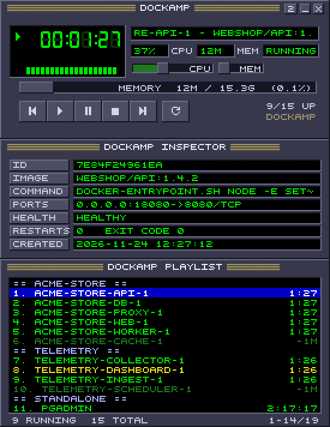
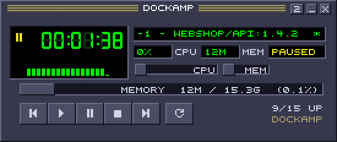
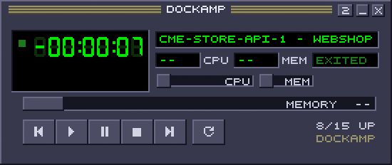

<div align="center">

# DockAmp

**A Docker container manager that looks like a late-'90s skinned MP3 player.**

Every container is a track. Uptime is the time on the LCD. Play, pause and stop really do
start, pause and stop your containers.



</div>

---

## Why

`docker ps` is fine until you have a dozen containers across a few Compose projects and you
keep re-running it to see what's up, for how long, and what's eating CPU. DockAmp keeps all of
that on screen in a small always-there window, and it gets out of the way: it is written in Rust,
event-driven, and idles at roughly 1% CPU and ~30 MB of its own memory.

## Features

- **Live container list:** all containers, grouped by Docker Compose project. Running ones come
  first; exited ones are dimmed and show how long ago they stopped.
- **Uptime LCD:** a 7-segment display with the selected container's uptime. It blinks while the
  container is paused and counts time since exit once it stops.
- **Live stats:** a CPU "spectrum analyzer" (the last ~20 s), CPU and memory meters, and a seek
  bar showing memory used against the memory limit.
- **Inspector:** ID, image, command, ports, health, restart count, exit code and created time.
- **Transport controls:** start, pause/unpause, stop and restart from the player buttons or the
  keyboard.
- **One-key rebuild:** `Shift+R` rebuilds or recreates a Compose service (see
  [Rebuilding](#rebuilding-shiftr)).
- **Event-driven:** it listens to Docker's event stream and never polls. Stats are streamed only
  for the selected container.
- **Crisp at any size:** the skin is drawn at native resolution and integer-scaled 1×/2×/3×. The
  pixel font, LCD digits and bevels are all drawn in code; there are no image assets.

| Paused: the LCD blinks                                        | Stopped: time since exit                                        |
|---------------------------------------------------------------|-----------------------------------------------------------------|
|  |  |

## Controls

| Button         | Key        | Action                                            |
|----------------|------------|---------------------------------------------------|
| ⏮              | `Z` / `↑`  | Previous container                                |
| ▶              | `X`        | Start (or unpause)                                |
| ⏸              | `C`        | Pause / unpause                                   |
| ■              | `V`        | Stop                                              |
| ⏭              | `B` / `↓`  | Next container                                    |
| ⟳              | `R`        | Restart                                           |
|                | `Shift+R`  | Rebuild / recreate the Compose service            |
| `1` `2` `3`    | `D`        | Cycle window scale 1× / 2× / 3×                   |
| `_` / `X`      |            | Minimize / close                                  |

In the playlist, click a row to select it and double-click to start it. The mouse wheel scrolls.
Drag any title bar to move the window.

Actions apply immediately with no confirmation dialogs. Their progress shows in the marquee
(`STOPPING...` → `STOPPED`). DockAmp never deletes containers, images or volumes.

## Rebuilding (`Shift+R`)

`Shift+R` runs this for the selected container:

```sh
docker compose up -d --build --force-recreate --no-deps <service>
```

The command uses the container's own Compose labels (project, working directory and config
files), so it works no matter where DockAmp was started from.

- **Services with a `build:` section** get their image rebuilt from the Dockerfile, then a new
  container is started.
- **Image-only services** are recreated. They re-read `docker-compose.yml` and `.env` and
  restart, so an app whose source is bind-mounted picks up your code changes. In a Spring Boot
  app, this is also when Flyway or Liquibase apply new migrations.
- **Volumes are never touched**, so your data survives.

The marquee streams the build output live. The full log is saved to
`~/.cache/dockamp/<container>.log`. Containers that weren't started by Docker Compose can't be
rebuilt.

## Install

### Requirements

- Linux with Wayland or X11, and OpenGL (Mesa is fine)
- Docker, with your user able to reach the socket (usually by being in the `docker` group)
- `docker compose` v2, only needed for `Shift+R`
- A recent stable Rust toolchain ([rustup](https://rustup.rs))

### Build from source

```sh
git clone https://github.com/sherbeenyy/dockamp.git
cd dockamp
cargo install --path .        # installs the `dockamp` binary into ~/.cargo/bin
dockamp
```

The release build is about 5 MB and has LTO enabled and symbols stripped.

### App launcher entry

Desktop sessions don't read your shell's rc files, so `~/.cargo/bin` is usually **not** on the
launcher's PATH. Install the entry with an absolute path:

```sh
sed "s|^Exec=.*|Exec=$HOME/.cargo/bin/dockamp|" assets/dockamp.desktop \
  > ~/.local/share/applications/dockamp.desktop
```

### Launch from the terminal without blocking it (zsh/bash)

```sh
alias dockamp='command dockamp >/dev/null 2>&1 &!'   # zsh; in bash use: ... 2>&1 & disown
```

### Remote Docker hosts

DockAmp respects `DOCKER_HOST`:

```sh
DOCKER_HOST=tcp://build-box:2375 dockamp
```

## How it works

```
┌──────────── UI thread (eframe / egui, glow) ────────────┐      ┌──── docker thread (tokio) ────┐
│ player · inspector · playlist                           │      │ bollard client                │
│   draw into a 275×356 CPU framebuffer                   │ ◀──  │  list + inspect once          │
│   → one texture, nearest-neighbour scaled               │ Upd. │  event stream → re-inspect    │
│ repaint ~1/s idle, ~5/s while the marquee scrolls       │ ──▶  │  stats stream (selected only) │
│                                                         │ Cmd  │  start/stop/…  compose rebuild│
└─────────────────────────────────────────────────────────┘      └───────────────────────────────┘
```

| Path                | What's in it                                                        |
|---------------------|---------------------------------------------------------------------|
| `src/model.rs`      | Container data, playlist sorting and grouping, time formatting (unit-tested) |
| `src/docker.rs`     | Background worker: events, inspect, stats, actions, compose rebuild |
| `src/skin/`         | Palette, framebuffer painter, bitmap font, 7-segment LCD            |
| `src/ui/`           | The player, inspector and playlist panels, plus hit-testing         |
| `src/main.rs`       | Window setup, app state and keyboard shortcuts                      |

## Development

```sh
cargo run            # debug build
cargo test           # model tests
cargo build --release
```

Issues and pull requests are welcome. Run `cargo test` and `cargo clippy` before opening a PR.

## License

[MIT](LICENSE)

DockAmp is an independent project. Its look is an original, procedurally drawn homage to the
skinned media players of the late '90s; no third-party skins or artwork are used.
